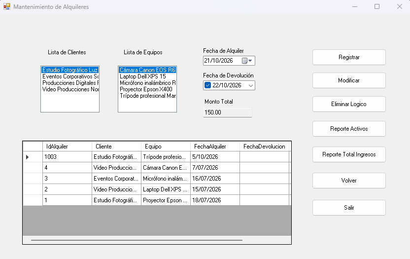
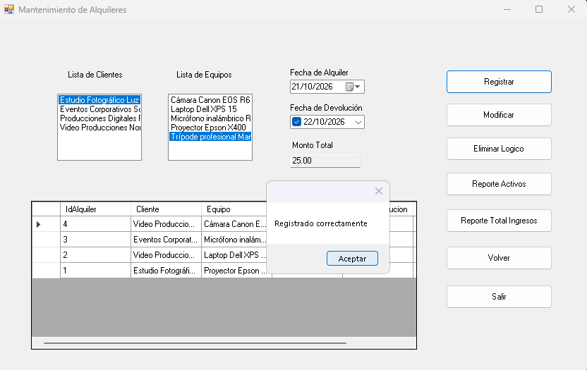
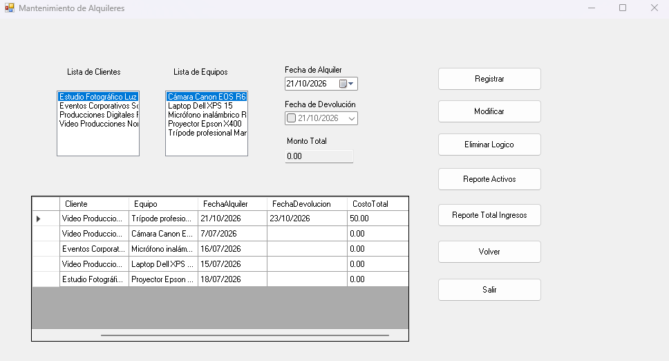
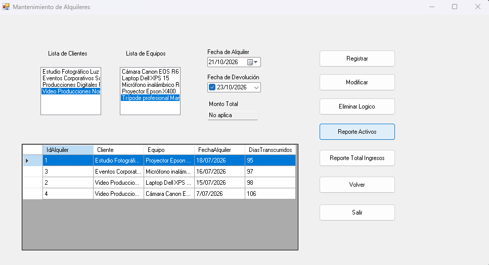

# Mantenimiento de Alquileres — C# / SQL Server

Proyecto **académico personal** desarrollado para el curso Fundamentos de Sistemas de Información. Es una aplicación de escritorio de **Windows Forms**, construida en **C# / .NET Framework 4.7.2**, con **Entity Framework 6 (Database First)** y **SQL Server**. Organiza el código en tres capas: presentación, negocio y datos.

## Funcionalidades

- Visualización de clientes, equipos y alquileres registrados.
- Registro de alquileres, con comprobación de disponibilidad del equipo.
- Modificación de alquileres y registro de la fecha de devolución.
- Cálculo del costo al registrar una devolución: días de alquiler × costo diario (mínimo un día).
- Eliminación lógica de alquileres **solo después de su devolución**.
- Reporte de alquileres activos y resumen de ingresos por cliente dentro de un rango de fechas.

## Capturas

Las siguientes capturas corresponden a la interfaz Windows Forms del proyecto:

### 1. Formulario principal


### 2. Registro de un alquiler


### 3. Registro de devolución


### 4. Reporte


## Tecnologías y organización

- `CapaAplicacion/`: Windows Forms y eventos.
- `CapaNegocio/`: clase `NAlquiler` para los métodos de negocio.
- `CapaDatos/`: clase `DAlquiler`, entidades y modelo `Model1.edmx` de Entity Framework 6.
- `database/crear_base_datos.sql`: definición de base de datos y **datos ficticios de clientes y equipos**.
- `Aquino.slnx`: solución Visual Studio con los tres proyectos.

## Requisitos

- Windows, SQL Server local y SQL Server Management Studio (SSMS).
- Visual Studio 2022 **17.13 o posterior**, con la carga de trabajo *Desarrollo de escritorio con .NET* y el paquete de desarrollo de **.NET Framework 4.7.2**.
- Conexión a SQL Server mediante autenticación de Windows.

## Ejecutar desde cero

1. Abre SSMS y conéctate a la instancia SQL Server local (por ejemplo `localhost` o `localhost\SQLEXPRESS`).
2. **Solo si la base de datos aún no existe**, abre `database/crear_base_datos.sql` y ejecuta el script completo una vez. Crea la base `202601_5494_DB_ALQUILERES`, las tablas `Cliente`, `Equipo` y `Alquiler`, cinco clientes y seis equipos (uno de cada tipo marcado como eliminado), **pero ningún alquiler**.
3. Verifica el resultado en SSMS:

   ```sql
   USE [202601_5494_DB_ALQUILERES];
   SELECT COUNT(*) AS Clientes FROM dbo.Cliente;
   SELECT COUNT(*) AS Equipos FROM dbo.Equipo;
   SELECT COUNT(*) AS Alquileres FROM dbo.Alquiler;
   ```

   La ejecución inicial correcta devuelve `5`, `6` y `0` respectivamente.
4. Abre `CapaAplicacion/App.config`. En `connectionStrings` adapta únicamente `data source` al servidor que utilizas: `localhost` para instancia predeterminada, o `localhost\SQLEXPRESS` para SQL Server Express. Mantén `initial catalog=202601_5494_DB_ALQUILERES`.
5. Abre `Aquino.slnx` en Visual Studio, restaura los paquetes NuGet y establece `CapaAplicacion` como proyecto de inicio.
6. Compila (Ctrl+Shift+B), ejecuta (F5) y prueba **Registrar → Modificar con fecha de devolución → Reporte de ingresos → Eliminar lógico**.

**Si ya tienes esta base con datos propios, no vuelvas a ejecutar el script de creación:** utiliza la base existente y confirma que contiene las tres tablas esperadas.

## Datos de demostración y reglas

La primera ejecución muestra clientes y equipos activos, pero la tabla de alquileres estará vacía. **Los alquileres se crean desde la interfaz** al pulsar Registrar. Al registrar un alquiler, el equipo pasa a no disponible; al consignar su devolución, vuelve a estar disponible. El costo se calcula al devolver el equipo. La eliminación lógica requiere un alquiler devuelto.

El script contiene únicamente datos ficticios de clientes y equipos. No se incluyen archivos `.mdf`, `.ldf`, binarios de compilación, paquetes NuGet ni claves privadas. La aplicación está pensada para un escenario de demostración y no para uso de producción.

## Observaciones técnicas

- Los archivos `Model1.*`, clases de entidades y plantillas `.tt` se generan desde Entity Framework Database First: se conservan porque participan en la compilación o regeneración del modelo.
- La carpeta `packages/` no está versionada: restaura las dependencias NuGet antes de compilar.
- No se incluyen registros iniciales de alquiler: estos se generan usando la interfaz.
- La disponibilidad se controla sobre el estado actual del equipo; **no implementa un motor completo de reservas futuras ni control de concurrencia transaccional entre múltiples usuarios**.
- El diseño utiliza fechas e importes de demostración; antes de usarlo en un negocio real hay que reforzar la validación de solapamientos históricos, controles de concurrencia, errores y pruebas.

## Limitaciones

No incluye instalador ni despliegue público; necesita una instancia SQL Server accesible en la máquina donde se ejecuta. Se recomienda reforzar el tratamiento de errores, concurrencia y pruebas automatizadas antes de su uso real.

## Autoría

**Diego Alberto Aquino Chaccara** — proyecto personal del curso Fundamentos de Sistemas de Información (UPC).
